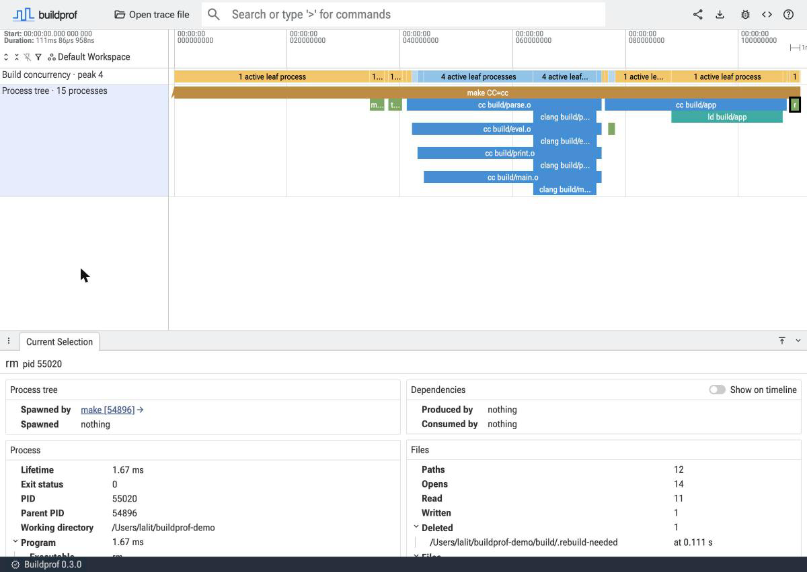
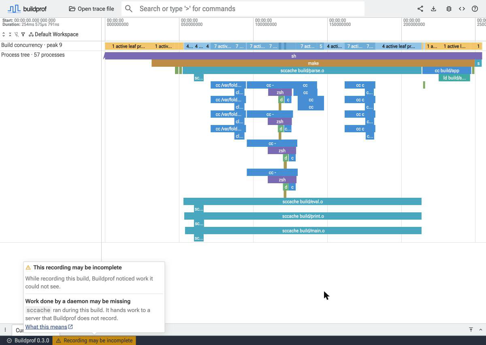

# Changelog

All notable changes to Buildprof will be documented in this file.

The format is based on [Keep a Changelog](https://keepachangelog.com/en/1.1.0/),
and this project follows [Semantic Versioning](https://semver.org/spec/v2.0.0.html).

## [Unreleased]

## [0.3.0] - 2026-11-08

We're excited to share Buildprof 0.3.0; the big new update in this release:
buildprof can now record builds on macOS!

Other improvements include: seeing which files a process deleted or touched,
opening buildprof URLs from the command line, tracing Clang compiler details
when it's run by absolute path, and much clearer guidance when the build
profile might be missing or broken.

### Record builds on macOS

`buildprof -- <command>` now works on macOS 13 and newer, and gives the same
familiar timeline as on Linux!

- **Root needed on startup.** buildprof uses `sudo` to turn on kernel
  tracing, then switches back to your user before your build starts. The
  [root policy](https://github.com/LalitMaganti/buildprof/blob/main/docs/root-policy.md) explains why we
  need root and what we do with it in detail.
- **Run it as yourself.** Buildprof refuses to run under `sudo` or as root. This is to
  prevent filling your output directories with files you can only touch with root.
- **Known gaps.** Due to fundamental OS limitations, macOS recording cannot be as precise
  as Linux: some SDK paths show as `<unknown>/...`, and a few very fast running
  commands show only their program name. The
  [new data loss page](https://github.com/LalitMaganti/buildprof/blob/main/docs/data-loss.md#unknown-paths)
  explains these limitations.

### See which files were deleted or touched

buildprof now records when a process deletes a file or changes its timestamp,
on both Linux and macOS. The UI lists these under "Deleted" and "Touched" in
each process's Files section. This helps explain why a build system re-ran a
step.

### Open a recording from a URL

`buildprof open <url>` downloads a buildprof recording and opens it in the UI. It accepts
any publicly accessible URL but also GitHub Actions artifact URLs which it accesses via
the `gh` CLI so even private recordings are supported.

Tied to this, the GitHub Action's job summary prints the command
for each recording. The [usage guide](https://github.com/LalitMaganti/buildprof/blob/main/docs/usage.md#opening-recordings)
has more details.

### Clang traces for toolchains that run Clang by path

`--compiler-traces` now traces Clang when the build system runs it via an absolute path, something
which affects many GN and CMake projects. The [compiler details page](https://github.com/LalitMaganti/buildprof/blob/main/docs/usage.md#compiler-details)
explains in more detail.

### See when a recording may be incomplete

When a build spawns a process that Buildprof cannot follow, such as a Docker
or Bazel daemon, the UI status bar now shows "Recording may be incomplete".
The [data loss page](https://github.com/LalitMaganti/buildprof/blob/main/docs/data-loss.md#work-done-outside-the-build) explains
each case.

### Other changes

- `--compiler-traces` keeps a compile's own `-ftime-trace` output, and no
  longer turns ccache hits into misses for Clang.
- Compiler wrapper steps are named after the compiler, such as `rustc`,
  instead of `buildprof-rustc-wrapper`.
- The UI is on a newer Perfetto, with everything from Perfetto v59.1.
- New example recordings of a no-op Node.js build.

## [0.2.8] - 2026-10-17

### Fixed

- Builds no longer run with `SIGPIPE` ignored. Buildprof passed its own
  ignored `SIGPIPE` on to the command it recorded, so pipelines such as
  `sort | head -n 1` printed "Broken pipe" errors instead of exiting quietly.

## [0.2.7] - 2026-09-16

### Fixed

- `--compiler-traces` no longer hangs when a compiler launcher such as ccache
  is on `PATH`. The launcher works out which compiler to run by looking its
  own name up on `PATH` again, where it found Buildprof's wrapper, which
  handed straight back to the launcher.

## [0.2.6] - 2026-09-13

### Added

- A GitHub Action that records builds, uploads traces, and adds elapsed time,
  exit status, and a download link to the job summary, including failed builds.
- A Nix flake with a package and development shell.
- Conformance coverage for npm, Bazel, and Buck2 builds.

### Fixed

- Filesystem tracing now records legacy `open` syscalls on x86_64, including
  those used by Alpine Linux builds inside containers.

## [0.2.5] - 2026-09-11

### Added

- Messages are coloured when they go to a terminal: errors red, hints yellow,
  and paths, URLs, and commands highlighted. `NO_COLOR` turns colour off and
  `CLICOLOR_FORCE` turns it on for pipes.
- The report printed after a recording is set apart from the build's output
  and is shorter: a headline, the port forward and URL on their own lines
  over SSH, the browser permission note, and the wait.

### Fixed

- `--compiler-traces` now collects nightly Rust self-profile data whenever
  the build runs a nightly compiler, including through `cargo +nightly` or a
  `rust-toolchain` file. The nightly check used to look only at the default
  toolchain at startup, so those recordings had no compiler tracks.

### Changed

- The one-request server that hands a trace to the browser is now built on
  tiny_http instead of hand-written HTTP parsing.
- While the UI waits for a trace from this machine, a dialog explains the
  browser prompt to access other apps and services on this device. The CLI,
  README, and error dialogs name the site setting that re-allows it: "Apps on
  device" in Chrome, "Access this device" in Firefox.

## [0.2.4] - 2026-09-11

### Changed

- The UI no longer probes localhost for a native Trace Processor when it
  starts. Chrome asked for permission to access other apps and services on
  the device for that probe before any trace was opened, and blocking it
  silently broke loading traces from the CLI.
- The CLI explains that Chrome permission prompt while it waits for the
  browser to fetch a trace, and how to recover after blocking it.
- When the UI fetches a trace from this machine, the loading page says to
  allow that prompt. If the fetch fails, the error says whether Chrome is
  blocking the site or nothing answered, and how to recover, instead of the
  generic download error.

## [0.2.3] - 2026-09-09

### Added

- `--no-file-events` records the process timeline without filesystem tracing,
  reducing overhead for builds that open many files. Compiler tracing remains
  independently selectable.
- Recordings carry their collection settings. The UI indicates when file
  events were not recorded and explains why file lists and dependency links
  are unavailable. Older recordings continue to open.

### Changed

- Event names and categories are written once per trace and referenced by id
  from each event, instead of being repeated as strings on every event. Traces
  are smaller and load faster; nothing changes in what the UI shows.

## [0.2.2] - 2026-09-04

### Changed

- The UI no longer calls out a recorder that differs from it only in the
  patch version; patch releases never change the trace format.
- Release notes list the same install options as the README, followed by the
  version's changelog section.

### Fixed

- `.deb` and `.rpm` packages for aarch64 are built on an arm64 runner instead
  of failing the sanity check on x86_64.

## [0.2.1] - 2026-09-04

### Fixed

- The static musl builds compile again; the ptrace request type differs
  between glibc and musl.
- Releases are created as drafts titled `Buildprof <version>` for review.
  Publishing one triggers the UI deploy, the crates.io publish, and the
  Linux packages, which a release published by automation never did.

## [0.2.0] - 2026-09-04

### Added

- `buildprof.version` and `buildprof.trace_format` trace attributes, visible
  in Trace Processor's `metadata` table, so the UI can tell which recorder
  wrote a trace.
- SSH sessions print the `ssh -L` port forward to run from your own machine
  instead of trying to launch a browser on the build host.
- `--wait <SECONDS>` bounds how long Buildprof waits for a browser to fetch a
  trace (default 600; 0 waits forever).
- `buildprof examples` and `buildprof open --example <NAME>` open recordings
  hosted next to the UI.
- Clear messages when ptrace or seccomp is unavailable (Docker without
  `SYS_PTRACE`, Yama `ptrace_scope` 3, gVisor), when the command cannot be
  executed, and when port 9001 is already taken.
- Prebuilt binaries on GitHub Releases for x86_64 and aarch64 Linux (glibc
  2.28 or newer, plus static musl builds) and for macOS, with a shell
  installer, a Homebrew tap, `.deb` and `.rpm` packages, and mise support.
- Every released UI is deployed permanently under
  `https://buildprof.lalitm.com/v<version>/`; the CLI opens the UI matching
  its own version and the UI links to the matching version when a trace was
  recorded by a different release.

### Changed

- Traces are now written as a single zstd stream, typically 9 to 20 times
  smaller than before. The UI detects the compression from the file's magic
  bytes and the `.buildprof` extension is unchanged. Querying a trace directly
  needs a Trace Processor build from July 2026 or later; the `perfetto` Python
  package's bundled build is older, so pass
  `TraceProcessorConfig(fetch_latest_trace_processor=True)` for now.
- Building from source now requires Rust 1.91.

## [0.1.0] - 2026-08-22

### Added

- Linux process-tree recording with command, working-directory, and exit-status
  metadata.
- File-open and rename events for reconstructing artifact flow.
- Perfetto trace output with packed process and file tracks.
- Optional Clang and nightly Rust compiler-internal traces.
- Conformance coverage for Make, CMake with Ninja, Meson with Ninja, Cargo, and
  Go builds.
