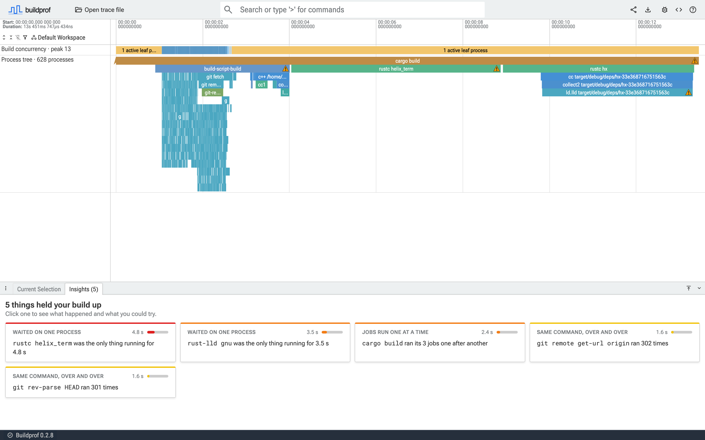
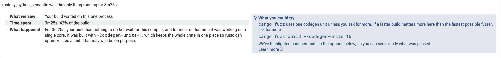
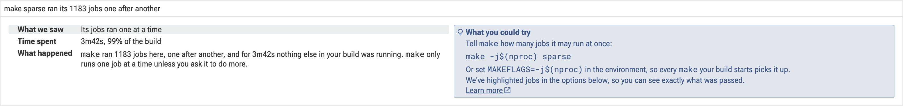
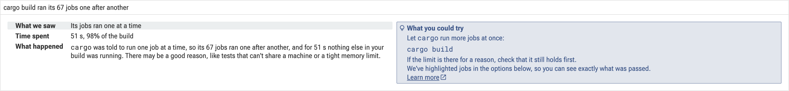

# Insights

When a recording opens, Buildprof looks for the places your build spent its
time waiting and lists them under **Insights**. Each one says what happened
and what you could try. This page explains each kind in more depth: why it
happens, what changing it costs, and how to tell whether the change helped.



Click a card to select the process it is about. Its details then say what
happened and what you could try, and link here.

The times in an insight are measured from the recording. The causes are read
from command lines, so treat them as likely rather than certain. A setting
named in an insight may well be there on purpose; the insight tells you what
it costs, so you can decide.

<!-- buildprof.lalitm.com/insights/ran-alone/codegen-units links here; see infra/buildprof.lalitm.com/assemble-site -->
## A compile with one codegen unit



rustc splits each crate into *codegen units* and hands them to LLVM to
optimize and compile in parallel. With `-Ccodegen-units=1`, the whole crate is
one unit, so that work happens on a single core. When nothing else in the
build is ready to run, the build waits for that one core.

People choose one codegen unit because LLVM can then optimize across the whole
crate: inlining and other optimizations are not limited to one piece at a
time. The result can be somewhat faster or smaller. With more units, rustc
still runs a cheap optimization pass across the pieces of the same crate
(thin local LTO), which recovers some, but not all, of that.

The setting an insight blames is highlighted where the process's details list
how it was run, with a link back to this page:


So the trade is build time against run time. It is usually worth it for a
release you ship, and usually not for builds that only feed tests, fuzzing or
development.

To give rustc more codegen units, set them in the profile the build uses:

```toml
[profile.release]
codegen-units = 16
```

If `-Ccodegen-units=1` comes from `RUSTFLAGS` or a `.cargo/config.toml`
instead, change it there. Profiles can also be set for one package with
`[profile.release.package.<name>]`, which lets you keep one unit only for the
crates where it matters.

### Under `cargo fuzz`

`cargo fuzz` builds with one codegen unit by default, except with `--dev`, to
make the fuzzer as fast as possible. `--codegen-units` overrides it:

```sh
cargo fuzz build --codegen-units 16
```

cargo-fuzz's own help describes 16 as "faster fuzz builds at the cost of
somewhat slower fuzz runs": the fuzzer may get through fewer inputs per
second. For a CI job that builds the fuzzers and runs each one briefly, the
faster build usually matters more. In one such CI job we recorded, the build
went from 360 s to 169 s.

<!-- buildprof.lalitm.com/insights/ran-alone/unoptimized-build-script links here; see infra/buildprof.lalitm.com/assemble-site -->
## An unoptimized build script


Cargo compiles build scripts, procedural macros and their dependencies with
the profile's `build-override` settings, which default to `opt-level = 0` even
in release builds. Most build scripts do very little, so compiling them
quickly is the right default.

Some do real work: generating code, building lookup tables, processing data
files. Unoptimized code can be many times slower, and while a build script
runs, the crates that depend on it cannot start. To compile build scripts with
optimization, set `build-override` in the profile you build with:

```toml
[profile.release.build-override]
opt-level = 3
```

This also optimizes procedural macros and the crates they depend on, which
makes them slower to compile. Whether it pays off depends on how much work the
script does, so time the build before and after. In one CI build we recorded,
it saved 45 to 86 seconds per job.

<!-- buildprof.lalitm.com/insights/ran-alone/none links here; see infra/buildprof.lalitm.com/assemble-site -->
## A process the build waited on


For the time shown, this process was the only thing your build was doing.
Everything else had either finished or was waiting for it. This is the part of
the build where making one process faster shortens the whole build, because
nothing else can fill the gap.

That is not necessarily a problem: some steps genuinely depend on each other,
and a build always ends with something. Things worth checking:

- **What it waits for.** The process's Dependencies section shows what it read
  and which processes made it. If those could be ready sooner, it could start
  sooner.
- **What waits for it.** The same section shows who read what it made. If they
  only need part of its output, splitting the work can let them start earlier.
- **Whether it could be split.** One large crate or translation unit
  compiles on one core; splitting it lets the pieces build side by side.

<!-- buildprof.lalitm.com/insights/serial-driver/serial-by-default links here; see infra/buildprof.lalitm.com/assemble-site -->
## Jobs run one at a time by default



`make` and `ctest` run one job at a time unless told otherwise. When the jobs
are independent, running several at once can finish in a fraction of the
time.

### make

Give `make` a job count, usually the number of CPUs:

```sh
make -j$(nproc)
```

Setting `MAKEFLAGS=-j$(nproc)` in the environment does the same for every
`make` the build starts, including ones started by scripts you don't control.
Prefer a number over a bare `-j`, which starts every job at once.

If the build fails or gives different results with `-j`, a rule is usually
missing a prerequisite: it worked serially only because of the order make
happened to pick. That is worth fixing anyway, since it can also break
incremental builds. A makefile can force one-at-a-time behaviour with the
`.NOTPARALLEL:` special target; if you find one, it may be there for that
reason.

### ctest

Ask `ctest` to run tests side by side:

```sh
ctest --parallel $(nproc)
```

`CTEST_PARALLEL_LEVEL` in the environment does the same. Tests that share
files, ports, databases or other state can fail only when they run together.
Rather than running everything serially, mark just those tests: the
`RESOURCE_LOCK` test property keeps tests that use the same resource apart,
and `RUN_SERIAL` runs a test on its own.

<!-- buildprof.lalitm.com/insights/serial-driver/one-job links here; see infra/buildprof.lalitm.com/assemble-site -->
## A tool told to run one job at a time



Something passed this tool a job count of one, such as `make -j1`,
`cargo build -j1` or `ctest --parallel 1`. There is often a reason: tests
that cannot share a machine, a build that runs out of memory when parallel, or
a workaround for a flaky failure.

If the reason still holds, this is what it costs, which can help when weighing
it against fixing the underlying problem. For tests, marking only the
conflicting tests (see [ctest](#ctest)) usually recovers most of the time. For
memory, a job count somewhere between one and the number of CPUs, or a load
limit such as `make -l`, can keep the machine within its limits while still
running jobs side by side.

<!-- buildprof.lalitm.com/insights/serial-driver/none links here; see infra/buildprof.lalitm.com/assemble-site -->
## Jobs that never overlapped


These jobs ran strictly one after another, but nothing on the command line
asked for that. Usually each job genuinely needs the one before it: a chain of
build steps, each consuming the previous one's output. The Dependencies
section of each job shows whether it read what the one before it wrote.

If they are independent, look at what starts them. A script that runs each
job and waits for it, a makefile with `.NOTPARALLEL:`, or a sub-make that did
not receive the parent's job slots can all serialize work that could run side
by side.

<!-- buildprof.lalitm.com/insights/repeated-command/none links here; see infra/buildprof.lalitm.com/assemble-site -->
## The same command, run over and over


The build ran the same command line many times. Each run may be quick, but
together they add up, and they often go unnoticed because no single one stands
out. Common sources are test helpers and build scripts that look something up
every time they are called: the workspace root, the git revision, a
compiler's version.

If the answer does not change between runs, compute it once and pass it down.
The insight names the process that started most of the runs, which is where
to look. Many tools let you skip the lookup by providing the answer in an
environment variable. For example, the `insta` snapshot-testing library runs
`cargo metadata` to find the workspace root unless `INSTA_WORKSPACE_ROOT` is
set; in one test suite we recorded, that lookup ran over 6,000 times.
